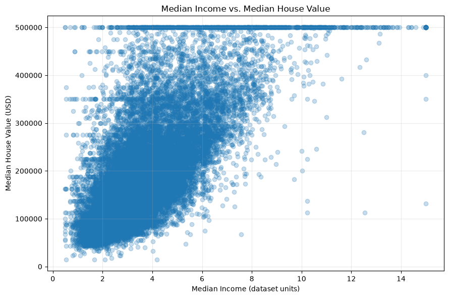
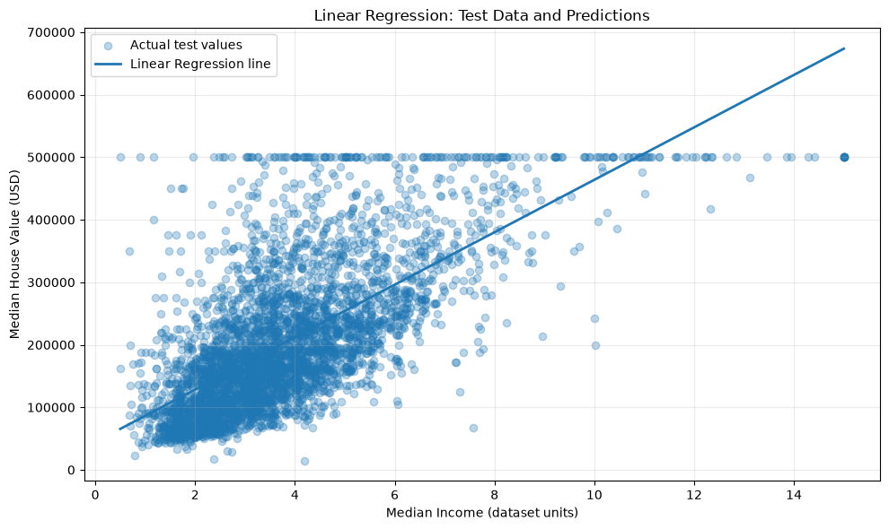

# California Housing Prices Prediction Using Linear Regression

A beginner-friendly machine learning project that uses **Simple Linear Regression** to predict California median house values from median household income. The project covers data exploration, train-test splitting, model training, evaluation, and visualization using Python and scikit-learn.

## Overview

**Objective:** Investigate the relationship between median income and median house value, and evaluate how well a one-feature linear regression model predicts housing values on unseen data.

- **Problem type:** Supervised learning — regression
- **Input feature:** `median_income`
- **Target variable:** `median_house_value`
- **Algorithm:** `sklearn.linear_model.LinearRegression`
- **Evaluation:** Held-out 20% test set

## Project Structure

```text
California Housing Prices using Linear Regression/
├── README.md
├── housing.csv
├── source_code.ipynb
├── requirements.txt
├── About Dataset.pdf
├── Source Code Explanation and Evaluation (pdf format).pdf
└── Visualizations/
    ├── median_income_vs_median_house_value.png
    └── linear_regression_test_data_and_predictions.png
```

## About the Dataset

The included `housing.csv` contains **20,640 California housing-area observations**. Although the dataset contains several housing and geographic variables, this experiment deliberately uses only two columns:

| Column | Role | Description |
| --- | --- | --- |
| `median_income` | Feature (X) | Median income in the area, expressed in dataset units (tens of thousands of US dollars) |
| `median_house_value` | Target (y) | Median house value in US dollars |

The notebook drops records missing either selected column before modeling. It reports **20,640 usable records**.

**Important:** These are area-level median values, not individual home sale prices. The dataset reflects historical housing information and should not be interpreted as current market prices.

## Methodology

1. **Load and inspect:** Read `housing.csv` with pandas and review the dataset's shape and sample rows.
2. **Select and clean:** Keep `median_income` and `median_house_value`; remove rows missing either value.
3. **Explore:** Plot median income against median house value to inspect their relationship.
4. **Split:** Use `train_test_split(test_size=0.20, random_state=42)` to create reproducible training and testing sets.
5. **Train:** Fit scikit-learn's `LinearRegression` model on the training set.
6. **Predict:** Generate predictions for the held-out test set.
7. **Evaluate:** Calculate MAE, MSE, RMSE, and R² on test predictions.
8. **Visualize:** Plot actual test observations alongside the fitted regression line.

The model follows the equation:

$$\hat{y} = b_0 + b_1x$$

where $\hat{y}$ is predicted median house value, $x$ is median income, $b_0$ is the intercept, and $b_1$ is the slope.

## Model Evaluation

The notebook reports these **test-set** results:

| Metric | Result | Interpretation |
| --- | ---: | --- |
| Mean Absolute Error (MAE) | **$62,990.87** | Average absolute difference between predicted and actual values |
| Mean Squared Error (MSE) | **≈ 7.09 billion USD²** | Squared-error metric that penalizes larger mistakes |
| Root Mean Squared Error (RMSE) | **$84,209.01** | Error measure in dollars, sensitive to large misses |
| R-squared (R²) | **0.4589** | Approximately 45.89% of test-set variation explained by this one-feature model |

**Dataset split:** 16,512 training records and 4,128 testing records.

The model finds a positive relationship between income and housing value, but its substantial prediction errors and moderate R² show that median income alone is not sufficient for accurate housing valuation. These are the results documented in the supplied notebook; running the notebook reproduces the evaluation.

## Visualizations

### Median Income vs. Median House Value



The scatter plot illustrates a positive association, with considerable variation in house values at similar income levels.

### Linear Regression: Test Data and Predictions



The fitted line captures the overall trend, while the spread of observed points around it shows the model's remaining error.

## Running the Project

**Prerequisites:** Python 3 and Jupyter Notebook or JupyterLab.

1. Download or clone this repository and open a terminal in the project folder.
2. (Recommended) Create and activate a virtual environment:

   ```bash
   python -m venv .venv
   ```

   Windows (PowerShell):

   ```powershell
   .\.venv\Scripts\Activate.ps1
   ```

   macOS/Linux:

   ```bash
   source .venv/bin/activate
   ```

3. Install dependencies:

   ```bash
   pip install -r requirements.txt
   ```

4. Open `source_code.ipynb` in Jupyter or VS Code, select the Python environment, and run all cells from top to bottom. Keep `housing.csv` in the same working directory as the notebook.

   If Jupyter is not already installed, install it with `pip install notebook` and launch it with `jupyter notebook`.

## Key Learning Points

- How to frame a numeric prediction task as supervised regression.
- How to distinguish a model's input feature from its target variable.
- Why an untouched test split is needed to assess generalization.
- How to fit and interpret the slope and intercept of a linear regression model.
- Why MAE, RMSE, and R² provide complementary views of performance.
- How scatter plots and residual distances reveal relationships and model limitations.


## Technologies Used

Python, pandas, NumPy, Matplotlib, scikit-learn, and Jupyter Notebook. See `requirements.txt` for the project's listed Python packages.

## Supporting Documents

- `About Dataset.pdf` — accompanying dataset documentation.
- `Source Code Explanation and Evaluation (pdf format).pdf` — accompanying explanation and evaluation report.

---

*This project is intended for learning and demonstration, not real-estate appraisal or financial decision-making.*
